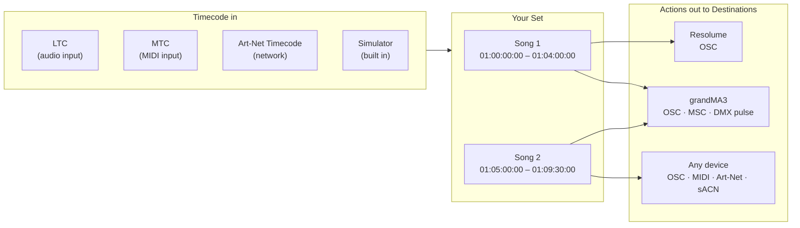

# TrigIT

[](https://github.com/jrikner/TrigIT/actions/workflows/ci.yml)

TrigIT is a small macOS app for show programmers. It listens to the show's timecode and, when the timecode enters a Song, sends that Song's cues to your other gear: Resolume, a grandMA3, or anything that takes OSC, MIDI, MIDI Show Control, Art-Net or sACN.

This README is the manual. Words with a capital letter (Set, Song, Action, Destination, Armed…) have one exact meaning, defined in [GLOSSARY.md](GLOSSARY.md).

- [What it does](#what-it-does)
- [Install](#install)
- [Your first Set in 5 minutes](#your-first-set-in-5-minutes)
- [Timecode Sources](#timecode-sources)
- [Actions](#actions)
- [Firing rules](#firing-rules)
- [Running a show](#running-a-show)
- [Troubleshooting](#troubleshooting)
- [License](#license)

## What it does



- A **Set** is your show: a list of **Songs**. Each Song has a span of timecode (start and end time), and can also be triggered by a MIDI note.
- When the timecode enters a Song, TrigIT sends that Song's **Start Actions** once. An **Action** is one message: an OSC message, a MIDI note, a MIDI Show Control command, or an Art-Net/sACN pulse on one DMX channel.
- Each Action goes to a **Destination**: a named device such as "Resolume" or "MA3", reached over OSC, MIDI and/or DMX.
- TrigIT follows a **Primary Source** of timecode and, if you give it one, switches to a **Backup Source** when the Primary is lost.

<!-- SCREENSHOT: Show screen with a current Song, light + dark, @2x -->

## Install

TrigIT needs macOS 13 (Ventura) or later, on Apple silicon or Intel.

1. Open the [Releases page](https://github.com/jrikner/TrigIT/releases) and download `TrigIT.zip` from the newest release. Beta versions are marked "Pre-release".
2. Double-click the zip to unpack it, and drag `TrigIT.app` into your Applications folder.
3. Open TrigIT. The app is signed and notarized by Apple, so macOS opens it without warnings.

To check the download, compare its checksum with the `TrigIT.zip.sha256` file next to it on the Releases page:

```bash
shasum -a 256 ~/Downloads/TrigIT.zip
```

A Homebrew install will come later.

### Windows (preview)

TrigIT isn't on Windows yet. A preview runs in a command window and shows a status page in your browser: it follows Art-Net Timecode or LTC and fires a Set's OSC Actions. Download it and test it with [the Windows guide](docs/windows-spike.md). It needs Windows 10 or 11 (64-bit, x64). To build it from source, see [CONTRIBUTING.md](CONTRIBUTING.md#building-on-windows).

### Permissions on first use

macOS asks for two permissions. Click **Allow** for both, or TrigIT can't do its job:

- **Microphone**, the first time you pick an LTC input: TrigIT reads LTC from an audio input, and macOS treats every audio input as a microphone.
- **Local Network**, the first time TrigIT sends to or listens on the network: OSC, Art-Net, sACN, and Art-Net Timecode all need it.

If you clicked Don't Allow, turn it back on in System Settings → Privacy & Security → Microphone (or Local Network), then quit and reopen TrigIT.

<!-- SCREENSHOT: macOS microphone permission prompt for TrigIT, light + dark, @2x -->

## Your first Set in 5 minutes

This uses the built-in **Simulator**, so you need no timecode, and sends one OSC message to Resolume. Have Resolume running with OSC input switched on in its Preferences (TrigIT's Resolume preset expects port 7000).

1. **Make a Set.** On the Welcome screen click **New Set**, choose where to save the file, and a three-step setup opens.
2. **Step 1, timecode:** choose **Simulator** as the type. Continue.
3. **Step 2, where to send:** choose **Resolume**. Type the IP address of the Mac running Resolume (`127.0.0.1` if it's this Mac); the OSC port is already 7000. Continue.
4. **Step 3, test fire:** send the test. Resolume receives the OSC address `/trigit/test`. Click **Done**.
5. **Add a Song.** You are now in **Edit** mode, in **Songs**. Click **+ Song**. TrigIT adds "Song 1", five minutes long at the start of the next free hour (for example 01:00:00:00 to 01:05:00:00). Change its start and end if you like; times are `hh:mm:ss:ff`.
6. **Add an Action.** Under Start Actions, choose **Add → From Resolume or grandMA3 Preset…**, pick **Resolume: launch column**, set Column to 1, and click **Add**. The Action sends `/composition/columns/1/connect` with the value 1 to Resolume.
7. **Try it.** The Simulator panel is at the bottom of the window. Click **Jump to 5 s before** next to Song 1. Five seconds later the timecode enters the Song and Resolume launches column 1.

TrigIT starts Armed, so the Simulator asks once before it drives the show: **Use the Simulator as the live timecode while Armed?** Click **Use the Simulator**. This guard stops a test run from firing real gear by accident.

Switch to **Show** mode (⌘1) to see what you'll watch during a show: the timecode, the current Song, how far into it you are, and the next Song.

<!-- SCREENSHOT: New Set setup, step 2 "Where should TrigIT send?" with Resolume chosen, light + dark, @2x -->
<!-- SCREENSHOT: Edit mode, Songs, a Song with one Resolume preset Action, light + dark, @2x -->
<!-- SCREENSHOT: Simulator panel with "Jump to 5 s before" buttons, light + dark, @2x -->

Other ways to start, all on the Welcome screen: **Open Example** creates a small example Set in Documents/TrigIT; **Import CSV…** makes a Set from a spreadsheet (see [Importing Songs from CSV](#importing-songs-from-csv)); **Open Recent** reopens a Set. Window → Welcome to TrigIT brings the Welcome screen back.

### Set files

A Set is one readable JSON file (`.trigit`). It saves itself a moment after every change and on quit; there is no Save command. File menu: New Set, Open Set, Open Recent, Save As, Show in Finder. Edit → Undo/Redo covers every change to the Set.

File → **Previous Versions…** lists the versions TrigIT kept: one when the Set is opened and one every two minutes while you edit, up to 100, stored in `~/Library/Application Support/TrigIT/Versions`. Restore any of them; the current Set is kept as a version first.

A file that can't be opened is never overwritten: TrigIT says why and starts an unsaved empty Set.

### Importing Songs from CSV

One Song per row: name, start, end, with times as `hh:mm:ss:ff`. Commas, semicolons or tabs all work, as do an optional header row and quoted names. Rows that are invalid, or would overlap another Song, are listed by line number and skipped; the rest are added.

A row can also carry an Action in five more columns: destination, kind (`osc`, `midi-note` or `dmx`), address, args or value, and when (`start` or `stop`). A row with an empty name, start and end adds another Action to the Song above. Destinations are matched by name, or added. A bad Action row loses only that Action. The format is the same as the grandMA3 plugin's, described in [ma3-plugin/README.md](ma3-plugin/README.md#csv-format). Use **Import CSV…** in Songs to add to the current Set, or on the Welcome screen to make a new Set.

```csv
name,start,end
Intro,01:00:00:00,01:04:00:00
"Song Two, extended",01:05:00:00,01:09:30:00
```

### Editing Songs

- **Capture:** play timecode to the right moment and click **Capture** next to the start or end time: it takes the live Playhead.
- **No overlaps:** every timecode position belongs to at most one Song. An edit that would overlap another Song is refused, and the Songs in the way are highlighted.
- **Notes instead of timecode:** turn **Timecode span** off and give the Song a Start Note and/or Stop Note (see [Start and Stop Notes](#start-and-stop-notes)).
- **Order:** a Song's Actions are sent in list order. Drag the handle to reorder.

## Timecode Sources

Choose sources in **Edit → Timecode**. The left column is the **Primary Source**; the right is the optional **Backup Source**, which must be a different type. Each column shows the live timecode, an input level, and the state of the source.

<!-- SCREENSHOT: Edit → Timecode with LTC as Primary and Art-Net Timecode as Backup, both receiving, light + dark, @2x -->

Frame rates: 24, 25, 29.97 drop-frame and 30 fps. TrigIT follows the rate of the incoming timecode; there is nothing to set.

TrigIT remembers its sources between launches.

### LTC (audio)

Type **LTC**, then pick the input as "device, channel". Feed LTC into that channel of an audio interface. The level meter shows whether signal arrives.

**From Ableton Live:** put the show's LTC audio file on its own track and route that track to an output of your audio interface, then cable that output into the input TrigIT listens on. TrigIT only needs a clean LTC signal on one channel; it does not care where it comes from.

### MTC (MIDI)

Type **MTC**, then pick the MIDI source. Every Core MIDI source is listed: physical ports, network MIDI sessions (set up in Audio MIDI Setup → MIDI Network Setup), and IAC buses.

**Same Mac as Ableton:** open Audio MIDI Setup, double-click IAC Driver, and tick "Device is online". The IAC bus then shows up both in Ableton's MIDI outputs and in TrigIT's MTC sources. Send MTC from your timecode player into that bus and choose it in TrigIT.

### Art-Net Timecode (network)

Type **Art-Net Timecode**, then pick the network interface it arrives on, or any interface. TrigIT listens on UDP port 6454, the Art-Net port, and shares it with other Art-Net software on the same Mac. When you pick one interface, packets arriving on any other interface are ignored.

**From a grandMA3 or other console:** send Art-Net Timecode to the Mac's IP address, or to the broadcast address of the network the Mac is on.

### The Simulator

Type **Simulator** gives you a timecode player inside TrigIT, for programming and testing without real timecode. Its panel at the bottom of the window has Play, Stop, a timecode field with **Play From** and **Jump**, a frame rate menu, and **Jump to 5 s before** for each Song. It never plays on its own after a launch.

### Stop detection

Under **Stop detection**, "Treat silence as a Stop after" sets how long timecode must be silent before TrigIT counts it as a Stop: 0.5 to 30 seconds, 2 s by default. See [Firing rules](#firing-rules).

## Actions

A Song has two lists: **Start Actions**, sent when the Song is entered, and **Stop Actions**, sent when it ends. Stop Actions are usually empty. Add an Action with **Add**, which offers each type, a preset, or Learn. Every Action names one Destination, and that Destination must have the Action's transport (OSC, MIDI or DMX) switched on.

The **Test** button on an Action sends just that Action now, even when disarmed, so you can check it while programming. After a failed send it reads **Retry**. **Add** is available once the Set has a Destination.

### Destinations

Set up devices in **Edit → Destinations**. Each Destination has a name and three transports, each switched on or off:

- **OSC:** the device's IP address and port, the network interface to send through (or Automatic), and an optional **Reply port**. If the device sends OSC back (Resolume's OSC output, a grandMA3), put the port it sends to here: a reply marks the Destination as online and responding.
- **MIDI:** a MIDI output (a port, a network MIDI session or an IAC bus), for MIDI note and MIDI Show Control Actions.
- **DMX:** Art-Net to an address (a node, or a broadcast address such as 2.255.255.255), sACN multicast, or sACN unicast; the network interface; and for sACN, the priority (0–200, default 100) and source name. Refresh rate is 30 times a second by default.

**Send Test** sends the OSC address `/trigit/test` to the Destination and checks it at once. A Destination that is used by an Action can't be deleted.

<!-- SCREENSHOT: Edit → Destinations, a grandMA3 Destination with OSC, MIDI and DMX on, light + dark, @2x -->

### OSC message

An OSC address and its arguments, sent over UDP to the Destination's address and port. Arguments are separated by spaces: `1` is an int, `0.5` a float, anything else a string; put a string with spaces in "quotes".

### MIDI note

A note, channel and velocity. TrigIT sends Note On, then Note Off 100 ms later. Notes still held are released at once when you disarm or quit.

### MIDI Show Control

GO, STOP or RESUME, with a cue, a cue list, and a device ID (0–111 one device, 112–126 a group, 127 every device). Cue and list are numbers like `5` or `12.5`; leave the cue empty for the next cue, and the list empty for the default list. A list needs a cue.

### Art-Net and sACN pulses

Sets one DMX channel in one universe to a value (255 by default) for a time (500 ms by default), then back to 0. Art-Net universes are port-addresses 0–32767; sACN universes are 1–63999.

Every universe a pulse Action uses is sent continuously, 30 times a second, from launch until quit, with zeros at rest. Receivers such as the grandMA3's DMX remote inputs never see the source disappear.

### Presets: Resolume and grandMA3

**Add → From Resolume or grandMA3 Preset…** fills in an ordinary OSC or MSC Action, which you can still edit afterwards. TrigIT doesn't remember which preset made it.

| Preset | Sends |
|---|---|
| Resolume: launch column | `/composition/columns/<column>/connect 1` |
| Resolume: launch clip | `/composition/layers/<layer>/clips/<column>/connect 1` |
| Resolume: clear layer | `/composition/layers/<layer>/clear 1` |
| Resolume: clear composition | `/composition/disconnectall 1` |
| Resolume: next column | `/composition/connectnextcolumn 1` |
| Resolume: previous column | `/composition/connectprevcolumn 1` |
| Resolume: tempo resync | `/composition/tempocontroller/resync 1` |
| grandMA3: Go+ executor (OSC) | `/cmd "Go+ Exec <page>.<executor>"` |
| grandMA3: command (OSC) | `/cmd "<any command line text>"` |
| grandMA3: GO cue in list (MSC) | MSC GO for a cue in a cue list (0 = the selected executor) |

**Resolume:** switch on OSC input in Resolume's Preferences and give the Destination the same port (TrigIT's preset uses 7000). The addresses follow Resolume 7's OSC list.

**grandMA3 over OSC:** on the console, set up an OSC line that receives on the Destination's port (the setup wizard uses 8000) and turn on **Receive Command** for it. If that line has a prefix, edit the Action's address to start with it, like `/gma3/cmd`.

**grandMA3 over MSC:** the console has to receive MIDI from the Destination's MIDI output, with MIDI Show Control input switched on.

### grandMA3 Timecode Show, no plugin

**File > Export > grandMA3 Timecode Show…** writes the Set as files a grandMA3 (2.5) imports itself, so the console fires the Set from its own timecode with no TrigIT running: the same Sequence and Timecode Show the [plugin's Import Show](ma3-plugin/README.md#import-show) makes, with the same rules and warnings. Choose the Sequence, Timecode and macro numbers, the timecode slot, the incoming timecode's frame rate (it decides when Stop Actions fire) and an In & Out OSC line for each OSC Destination. The new folder holds:

- `trigit_seq<n>.xml`, `trigit_tc<n>.xml` and `trigit_macro<n>.xml`: copy them into the console's library, under `gma3_library/datapools/sequences`, `timecodes` and `macros` (on a USB stick, the same folders);
- `README.txt` with the steps: `Import Macro <n> "trigit_macro<n>"` on the command line, then run the macro. It deletes the Timecode and Sequence at the chosen numbers and imports the Set there. The Sequence must stay at its number: the Timecode's events point at its cues by number.

OSC lines can't be made by a command, so set them up by hand in Menu > In & Out > OSC, as the README lists: the Destination's IP and port, Send Command on, Send off, and an interface. MIDI Show Control Actions are left out: grandMA3 can't send them.

<!-- SCREENSHOT: "Add Action from Preset" sheet with grandMA3: Go+ executor chosen, light + dark, @2x -->

### Learn

Program by example. **Add → Learn from MIDI or OSC…** listens on the MIDI inputs you switch on and on an OSC port you choose (8000 by default; not 6454, which is Art-Net's). The first message that arrives becomes the Action:

- a Note On becomes a MIDI note Action with its channel, note and velocity;
- an MSC GO, STOP or RESUME becomes an MSC Action;
- an OSC message becomes an OSC Action with the same address and arguments.

Learn stops on its own after 30 seconds. The **Learn** buttons next to a Song's Start Note and Stop Note work the same way: the next Note On sets the note.

<!-- SCREENSHOT: Learn sheet listening, with MIDI inputs and OSC port, light + dark, @2x -->

## Firing rules

These rules decide when Actions go out. The **Playhead** is the timecode position TrigIT is following.

- **Entering:** the Playhead arrives inside a Song's span from outside it, either by playing into it or by a Jump landing anywhere inside it. The Song's Start Actions are sent once. Moving or jumping within the same Song never sends them again.
- **Ending:** the Playhead plays on past the Song's end time. Its Stop Actions are sent once, before the next Song's Start Actions. A Jump out of a Song, or playing backwards out of it, sends nothing.
- **Stop:** timecode goes silent on every source for longer than the Stop time (2 s by default), as when Ableton's transport stops. A Stop is not Ending: nothing is sent, and the Song stays current. But it is re-armed: if timecode resumes inside the same Song, its Start Actions are sent again. If timecode resumes somewhere else, that counts as a Jump.
- **Dropout:** a gap in timecode longer than 0.2 s but shorter than the Stop time. It is logged and never re-fires a Song.
- **Jump:** timecode arriving more than 5 frames away from where normal playback would be: a skip forward or back, or starting mid-show. A Jump into a Song is Entering; a Jump out of one Ends nothing.

Timecode between Songs belongs to no Song: nothing is sent there.

### Start and Stop Notes

To fire Songs without timecode (a DJ pull-up triggered from Ableton, say), choose where notes come from in **Edit → Timecode → MIDI notes** (it may be the same port as MTC), then give the Song a Start Note and/or Stop Note (channel and note number).

- A **Start Note**'s Note On makes the Song Enter, unless it is already current.
- A **Stop Note**'s Note On makes the Song End if it is current. A Song with only a Stop Note sends its Stop Actions every time the note arrives.
- One Song's Stop Note can be another Song's Start Note: a hand-off. The same note used twice in other ways is a **Note Clash**: the editor warns about it but allows it.

Note Off, and Note On with velocity 0, are ignored.

## Running a show

### Show mode and Edit mode

The switch at the top of the window chooses **Show** (⌘1) or **Edit** (⌘2). Show mode is made to be read from a few metres away: the live timecode and source, the current Song with how far into it you are, the next Song and how long until it starts, and the whole Set with each Song marked current or fired.

<!-- SCREENSHOT: Show mode, Disarmed, light + dark, @2x -->

### Armed

**Armed** (⇧⌘A, the button at the top right) is the master switch. Armed, Songs send their Actions. Disarmed, TrigIT still follows the timecode and shows which Song is current, but sends nothing. Disarming also releases any held MIDI notes and clears the "fired" marks.

TrigIT is Armed every time it launches. A Song the timecode entered while disarmed is not shown as playing until it is entered again while Armed.

To send a Song by hand, open it in Edit → Songs: **Send Start** sends its Start Actions and **Send Stop** its Stop Actions, even when disarmed. These buttons are in Edit mode, so under Show Lock you turn the lock off first.

### Show Lock

**Show Lock** (the lock button in Show mode) makes the Set read-only for the show and keeps TrigIT in Show mode: Edit is unavailable until you turn Show Lock off. Arming and the Simulator still work.

### Backup Source failover

Give the show a Backup Source in Edit → Timecode, for example LTC as Primary and Art-Net Timecode as Backup. Then:

- When the Primary goes silent for more than 0.25 s while the Backup is running, TrigIT switches to the Backup and carries on from where it was: no Stop, no Dropout, nothing re-fired. A banner says **Primary LTC lost. Following Backup Art-Net Timecode.**
- When the Primary comes back, TrigIT stays on the Backup until the next Stop, so the show never switches back mid-song. After a Stop it follows the Primary again.
- If both go silent, the banner says **No timecode from LTC or Art-Net Timecode. Holding the last frame.** until timecode returns or the silence becomes a Stop.

Every switch is written to the Fire Log.

<!-- SCREENSHOT: Show mode with the failover banner "Primary LTC lost. Following Backup…", light + dark, @2x -->

### If TrigIT quits or crashes mid-show

If TrigIT crashes or is force-quit, the next launch reopens the last Set straight away, Armed, following the same Timecode Sources. The first timecode it hears inside a Song counts as Entering, so that Song's Start Actions go out once more, on purpose, to bring the devices back in sync. After a normal quit, the next launch shows the Welcome screen.

To have macOS relaunch TrigIT within seconds of a crash, install the launch agent. It also starts TrigIT at login; quitting with ⌘Q leaves it quit. Download the install script from this repository and run it (it expects TrigIT in /Applications):

```bash
curl -fsSLO https://raw.githubusercontent.com/jrikner/TrigIT/main/scripts/install-launch-agent.sh
```

```bash
bash install-launch-agent.sh
```

To remove it:

```bash
bash install-launch-agent.sh --uninstall
```

### Logs

**Edit → Fire Log** lists everything that happened: each firing, every send and whether it failed, Dropouts, Stops, failovers, arming, and problems. Filter it by kind, and **Export…** it as a CSV file.

The same lines are written to a daily file in `~/Library/Logs/TrigIT/` (for example `2026-11-07.log`), so you can read what happened after the show. Files older than 30 days are removed.

<!-- SCREENSHOT: Edit → Fire Log after a few Songs fired, light + dark, @2x -->

## Troubleshooting

**No timecode.** Open Edit → Timecode and watch the source's readout and level.

- LTC: check the level meter moves. If it doesn't, check the cable, the input and channel, and that TrigIT has microphone permission (System Settings → Privacy & Security → Microphone). If the Fire Log says "LTC device is not connected; waiting for it", plug it in: TrigIT picks it up again by itself.
- MTC: check the IAC bus is online (Audio MIDI Setup), or the network MIDI session is connected, and that the source is really sending MTC.
- Art-Net Timecode: check the sender targets this Mac's address or its network's broadcast address, that the chosen interface is the one it arrives on (or choose any interface), and that TrigIT has Local Network permission.

**A Destination is offline.** A red dot next to Destinations, and a banner, say which one and why: "not responding" (pings and OSC replies stopped), "send failed", "network interface … is gone", or "MIDI output … is gone". Check the device is on, the IP address and port, and the network interface. Click **Send Test** to check again. Art-Net to a broadcast address and sACN multicast can't be pinged, so without a reply port TrigIT can't prove such a Destination is there; check on the receiving device instead.

**A Song didn't fire.** Look in the Fire Log at the moment it should have fired.

- "(disarmed, nothing sent)": TrigIT was disarmed. Arm it.
- Nothing logged: the timecode never entered the Song. Check the Song's start and end against the timecode you play. A Jump that lands inside the Song fires it; staying inside it, or coming back after a Dropout, doesn't fire it again.
- A "Failed" line: the send itself failed; the line says why.
- "Action skipped, its Destination was deleted": point the Action at a Destination.
- Fired, but the device did nothing: the message arrived but the device ignored it. Check the device's OSC/MIDI/DMX input settings, and for a grandMA3, Receive Command and any OSC prefix.

**Where are the logs?** In the app: Edit → Fire Log. On disk: `~/Library/Logs/TrigIT/`, one file per day.

## Contributing

To build TrigIT from source, run the tests, or send a change, see [CONTRIBUTING.md](CONTRIBUTING.md).

## License

Originally created by Jonathan Rikner. © 2026 Jonathan Rikner.

TrigIT is free software under the GNU General Public License, version 3 or (at your option) any later version (`GPL-3.0-or-later`); see [LICENSE](LICENSE). [NOTICE](NOTICE) adds one term under GPL §7(b): modified versions must keep the attribution "Originally created by Jonathan Rikner" in their README and in the app's About window.
