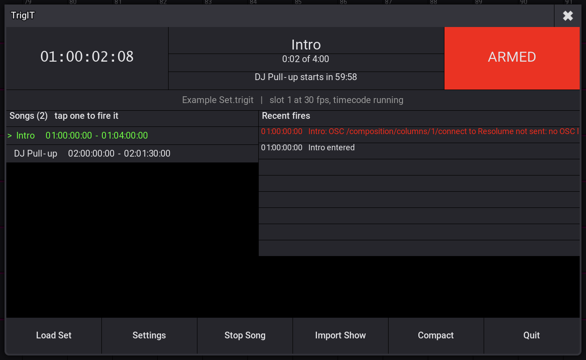
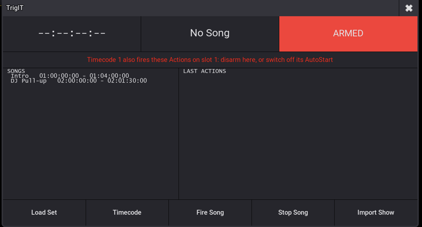
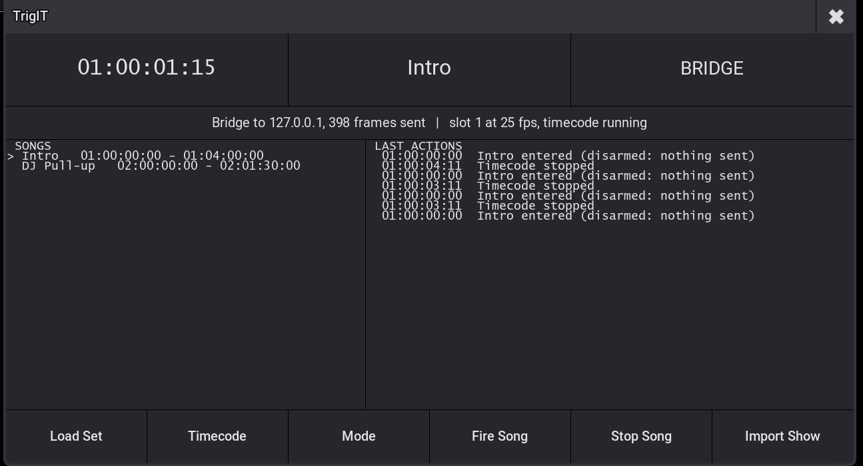

# TrigIT for grandMA3

A grandMA3 plugin that runs a TrigIT Set on the console, in one of two modes (`docs/adr/0003-ma3-plugin-modes.md`):

- **Standalone** (#47): its panel loads a Set (a `.trigit` file), follows a timecode slot with TrigIT's Show Engine, and sends the Set's OSC and MIDI Actions while Armed.
- **Bridge** (#46): it sends the timecode slot to the TrigIT Mac app as Art-Net Timecode, and the Mac app fires.

It can also import a Set (`.trigit` or CSV) as a Timecode Show, so MA's own timecode engine fires the Actions without the plugin running (#30).

Tested on **grandMA3 onPC 2.5.1** (macOS), not yet on a console (spike #43). It is written for 2.5; older versions may refuse the plugin file.

## Install

1. Copy `dist/TrigIT.xml` and `dist/TrigIT.lua` into a folder of the MA3 library's plugins folder:
   - onPC: `~/MALightingTechnology/gma3_library/datapools/plugins/TrigIT/` (macOS), or the same path under your user folder on Windows.
   - Console: on a USB stick, `grandMA3/gma3_library/datapools/plugins/TrigIT/`.
2. In a Plugins pool window, edit an empty pool object, tap **Import**, and choose `TrigIT.xml`. Or type `Import Plugin <n> /Path "<that folder>" /File "TrigIT.xml"` on the command line.
3. Put your Set files in `gma3_library/trigit/`, or at the top of a USB stick, or in a `trigit` folder on it. Export the `.trigit` from the Mac app, or write a CSV (below).

## The panel

Run the plugin (tap it, or type `Plugin <n>`). It opens the TrigIT panel:



- **Top:** the Playhead (the timecode on the slot, grey while timecode is lost), the current Song with how far into it you are (`0:02 of 4:00`), the next Song and when it starts (`DJ Pull-up starts in 59:58`), and **Armed**. Tap Armed to arm or disarm; it turns red when armed. The panel opens disarmed.
- **Status line:** the Set, the slot and frame rate it follows, and whether timecode is running. It becomes a red banner for an alert: timecode lost, a CSV Set (which can only be imported), or an imported Timecode Show on the same slot that would fire the same Actions a second time:

  

- **Songs:** the Set's Songs and their spans. The current Song is green with `>`; Songs that fired are grey and marked `(fired)`. Tap a Song to send its Start or Stop Actions by hand, even while disarmed, or to edit it. With more than ten Songs, the list follows the current one.
- **Recent fires:** what happened, newest first: Songs Entered and Ended, each Action sent, Jumps, Stops and Dropouts. An Action that was not sent is red, with why.
- **Set:** Load Set (a `.trigit` file from the folders below; the panel remembers it, with its settings, in the show's global variables, and loads it next time), New Set, Add Song, and Show Lock (below).
- **Settings:** the timecode slot and frame rate to follow, and the mode: Standalone, or Bridge with the bridge computer's IP address (or a broadcast address). Changing any of them disarms TrigIT. MA reads the incoming frame rate but doesn't pass it on to plugins, so set it here: TrigIT needs it to place each Song's end to the frame.
- **Stop Song:** send the current Song's Stop Actions, even while disarmed.
- **Import Show:** write the Set as a Timecode Show (below), with the panel's slot and frame rate as defaults.
- **Compact:** shrink the panel to the Playhead, the current Song, Armed and the status line, small enough to keep open next to the console's own views; **Full** brings the rest back. The console stays usable around the panel. Drag it by its title bar: each size reopens where you left it.
- **Quit:** stop TrigIT. It disarms, stops following timecode and sends nothing until you run the plugin again. The panel stays, saying TrigIT stopped: close it with its ✖.

The panel sends OSC on the In & Out line named `TrigIT <Destination>` (an import makes it), or else the first line with the Destination's IP and port. Closing the panel with its ✖ only hides it: TrigIT keeps following timecode and, while Armed, keeps sending. Run the plugin again to reopen the panel on the same Set, Armed state and log. Use **Quit** to stop it.

Only one TrigIT runs at a time. Running the plugin while TrigIT runs opens its panel; it never starts a second one. Loading another show, or importing the plugin again, stops the running TrigIT and disarms it. Quit TrigIT before you delete or re-import the plugin: deleting a plugin from Lua crashed onPC 2.5.1 in testing.

Use the panel or an imported Timecode Show for a Set, not both: both fire the same Actions.

## Making and editing a Set

The console can make a Set on its own, no Mac needed:

- **Set > New Set** makes an empty Set and saves it in the library's `trigit` folder.
- **Set > Add Song**, or tap a Song and **Edit**: its Name, Start and End (hh:mm:ss:ff). **Start = Playhead** and **End = Playhead** take the timecode on the slot now, so you can play the track and press at the right moments. **Delete** removes the Song.
- **Actions** in the Song's dialog lists its Actions; tap one to remove it. **Add Action** offers the Mac app's presets (Resolume: launch column, launch clip, clear layer, clear composition, next and previous column, tempo resync; grandMA3: Go+ executor and command, over OSC), or type an OSC message, MIDI note or DMX pulse as in the CSV columns. A new Destination asks for its IP address and port.

The same rules as the Mac app apply: a Song needs a name, its End can't be before its Start, and no two Songs share a frame. Every change is saved to the Set's file at once, and the running show takes it without firing anything, Armed or not. The file is the Mac app's own format: it opens there unchanged, and fields the console doesn't edit are kept.

**Show Lock** (Set > Show Lock) makes the Set read-only for the show, as in the Mac app: no editing, while arming and firing still work. The status line says so, and the panel remembers it.

## Commands

Put these in a macro, on an executor or on the command line, with the plugin's number or name:

| Command | Does |
|---|---|
| `Plugin TrigIT` or `Plugin TrigIT "open"` | Open the panel |
| `Plugin TrigIT "start"` | Start TrigIT, disarmed, without opening the panel. Does nothing if it runs already. |
| `Plugin TrigIT "arm"`, `"disarm"`, `"toggle"` | Arm or disarm |
| `Plugin TrigIT "fire Intro"` | Send that Song's Start Actions, even while disarmed. The name isn't case-sensitive. |
| `Plugin TrigIT "stop"` | Send the current Song's Stop Actions |
| `Plugin TrigIT "screen 2"` | Open the panel on screen 2 from now on. If it is open, close it and open it again to move it. |
| `Plugin TrigIT "quit"` | Stop TrigIT, as the Quit button does |

They act on the running TrigIT. If it isn't running, any command but `quit` starts it first, with the Set, slot and mode it remembers, and only `open` (or no command) opens the panel. Each command says what it did in the System Monitor. In bridge mode the Mac app arms and fires, so `arm`, `fire` and `stop` say so and do nothing.

## Starting with the show

Loading a show ends every plugin, TrigIT too, and MA3 has no hook to start one when a show loads. So the first time TrigIT starts in a show, it makes a macro **TrigIT start** (`Plugin "TrigIT" "start"`). Run it after loading the show, or put it on a key: TrigIT starts with the Set, slot and mode it remembers, disarmed, without opening the panel. Delete the macro if you don't want it; TrigIT won't make it again in that show. If you rename the plugin, edit the macro's line to match.

## Bridge mode



The plugin sends each new frame on the slot to the Mac as an ArtTimeCode packet (UDP 6454, stream 0), with LuaSocket. In the Mac app, choose Art-Net Timecode as the Timecode Source. The panel shows the frames sent. It still loads a Set and runs the engine, always disarmed, so you can see the Song the Mac should be in. Arming and firing are on the Mac.

It is not frame-accurate: MA updates a slot about 24 times a second, so the Mac gets about 20 frames a second, with steps of one or two frames. That is within the Mac engine's Jump tolerance, but firing can be up to two frames later than from the source itself. MA also runs the slot on for its afterroll (0.5 s) when timecode stops.

## Import Show

**Import Show** asks, one dialog at a time:

1. **Which Set.** It lists every `.trigit` and `.csv` it finds in those folders.
2. **Frame rate, timecode slot, and numbers.** The frame rate is the incoming timecode's: the Set stores none, and it decides when Stop Actions fire. The Timecode and Sequence numbers must be free or from an earlier TrigIT import. It suggests free ones.
3. **An OSC line per OSC Destination.** It picks the line it made last time, or one with the same address, or offers to make a new line `TrigIT <Destination>` from the Set's IP and port (type them for a CSV Set). Choose **Leave out** to skip that Destination.
4. **A summary** with every warning (skipped Songs, Actions it can't send). The warnings also go to the System Monitor.

On **Import** it writes:

- **Sequence** `TrigIT <Set>`: one cue per moment, named after its Song (`Intro start`, `Intro stop`, `Intro note off`). Each cue's Command holds that moment's Actions, joined with `;`.
- **Timecode** `TrigIT <Set>`: one track playing that sequence, with a `Goto` event per cue at its time. It follows the chosen slot, and starts and stops by itself when timecode arrives and stops (Auto Start, Auto Stop).
- **OSC lines** in In & Out, when you asked for new ones: Send Command on, Send off. Without Send Command, MA3 refuses `SendOSC`. With Send on, MA3 would also send its own playback feedback to the device.

Importing again, with the same or another Set, replaces that Timecode and Sequence. The plugin finds them by their Note and never touches anything else. **Oops** undoes an import.

OSC needs an interface: if Menu > In & Out > OSC shows Interface "None", choose one there. The summary says so.

## What was checked on onPC 2.5.1

- The panel: Load Set, Timecode, Fire Song and Import Show open their dialogs and work; Armed toggles; the panel stays live while its loop runs at about 30 Hz.
- Closing the panel (#94): with the panel closed and Armed, the slot's generator running across 01:00:00:00 Entered Intro and sent its Action; running the plugin again reopened the panel on the same run with that log. Quit disarmed and stopped it, with the panel left open saying so. A changed run token (as after a re-import or a show load) stopped the loop and closed its panel.
- Panel (#97): Playhead, current Song with its progress, next Song with its countdown, the red alert banner, fired and current Song rows; tapping a Song row offered Fire Start, Fire Stop and Cancel, and Fire Start sent it; Settings showed slot, rate, mode and IP in one dialog.
- Set editor (#96): New Set saved a file; Add Song with Name, Start and End in that order; an overlapping Song was refused with 'overlaps "Opener"'; Show Lock hid Edit; Add Action offered the presets, and Resolume: launch clip added `/composition/layers/2/clips/5/connect 1`, saved at once. The Mac app's SetFile.decode opened the saved file with that Action.
- Commands (#98), sent with `Plugin <n> "..."`: `arm` started TrigIT without its panel, Armed; `open` showed it; `fire intro` fired Intro; `toggle` disarmed; `stop` stopped the current Song; `quit` stopped TrigIT; unknown commands and Songs changed nothing.
- Compact panel (#95): Compact and Full switch; the rest of onPC stayed usable with the compact panel open; dragged, it came back at the same place after Full and Compact; `screen 2` was refused on a one-screen onPC and `screen 1` stored.
- Start macro (#99): the first `start` made Macro "TrigIT start"; after the loop was stopped as a show load would, running the macro started TrigIT again, disarmed, without its panel; running it again changed nothing; no second macro was made.
- Bridge mode to 127.0.0.1: ArtTimeCode packets arrive with the slot's timecode and rate type, about 20 a second (steps: 1 frame 80%, 2 frames 20%, rarely 2–4 back), and stop 0.5 s after the input does. Not yet with the Mac app itself.
- Armed, with Art-Net Timecode from 00:59:58:00 on slot 1 at 30 fps: the panel shows the Playhead, Enters Intro at 01:00:00:00 and sends `/composition/columns/1/connect 1` once. When timecode stops it shows Timecode lost, then logs the Stop after the Stop time. Fire Song sends while disarmed.

- `SendOSC` sends the same bytes as the Mac app for int, float and string arguments, UTF-8, `;` inside strings, and messages with no arguments (`"/address,"`). MA3 refuses a bare `"/address"`.
- The example Set, imported with Art-Net Timecode on slot 1, fires Resolume's `/composition/columns/1/connect 1` 25–58 ms after 01:00:00:00 arrives at 30 fps, over 4 runs, and a 4-cue Set fires each cue 52–59 ms after its frame at 25 fps. That is one to two frames, from MA3's own timecode handling.
- Importing a second Set replaces the first: one Timecode, one Sequence, and the same OSC line.
- Timecode events targeting a **macro** never ran in onPC 2.5.1, so the plugin targets a sequence and puts the commands in cue Commands.

## Differences from the Mac app

The panel runs the Mac app's Show Engine, with the same rules. It follows one slot: no Backup Timecode Source, and no Start or Stop Notes yet, since MIDI input to a plugin is unchecked (#43). A CSV Set can be imported but not followed. The differences below are those of an imported Timecode Show.

- **Jumps:** starting timecode in the middle of a Song doesn't fire its Start Actions. The Mac app does, because a Jump landing inside a Song Enters it. MA3 only fires events the playhead passes.
- **Stops:** MA3 runs on for its slot's afterroll (0.5 s by default) when timecode stops, so a Stop cue within that time still fires.
- **Not sent:** MIDI Show Control and DMX pulse Actions, Songs with only Start or Stop Notes, and OSC strings containing `,` or `"`. Each is listed as a warning.
- **MIDI** goes out of the console's MIDI output, whichever Destination it names. A note is held 0.1 s, as in the Mac app.
- **Drop-frame:** at 29.97 DF, times are counted in real seconds (frames × 1001/30000). This is not checked against MA3's own DF handling yet.

## Files

- `src/trigit_plan.lua`: `fromCSV(text, options)` and `fromTrigit(text, options)` turn a Set into a plan. Pure Lua, no MA calls.
- `src/ma3.lua`: turns a plan into the cues the plugin writes. Pure Lua.
- `src/commands.lua`: every MA3 command the plugin writes, formatted in one place.
- `src/engine.lua` and `src/timecode.lua`: TrigIT's Show Engine ported from `Sources/TrigITEngine/ShowEngine.swift` (#47). Pure Lua. `spec/engine_spec.lua` ports the Swift engine tests one for one.
- `src/live.lua`: the engine on the console: slot seconds in, MA commands and the panel's log out. Pure Lua.
- `src/artnet.lua`: ArtTimeCode packets for bridge mode. Pure Lua.
- `src/json.lua`: a small JSON decoder and encoder for `.trigit` files.
- `src/arguments.lua`: reads the commands above. Pure Lua.
- `src/setedit.lua`: making and editing a Set, the Mac app's presets, and writing the `.trigit` file. Pure Lua.
- `src/view.lua`: what the panel shows: progress, countdown, fired Songs. Pure Lua.
- `adapter/TrigIT.lua`: the MA3 side: the panel and its loop, dialogs, OSC lines, the Sequence and the Timecode. The only file that calls MA.
- `docs/`: screenshots of the panel on onPC.
- `build.lua`: bundles all of these into `dist/` (an MA3 plugin can't `require` files). Run `lua build.lua` after changing them, and commit `dist/`. CI fails if it is out of date.
- `spec/`: busted tests. `spec/fixtures/*.trigit` are written by the Swift tests (`Tests/TrigITStorageTests/MA3FixtureTests.swift`). After changing those Sets or the file format, run `TRIGIT_WRITE_FIXTURES=1 swift test --filter MA3FixtureTests`.

## Run the tests

```bash
cd ma3-plugin && busted && lua build.lua --check
```

You need Lua 5.4 (the MA3 runs 5.4.8) and `luarocks install busted`. The adapter has no unit tests: check it on onPC with the procedure below.

## Checking on onPC

1. Import the plugin (above) in a scratch show, and copy `spec/fixtures/example.trigit` to `gma3_library/trigit/`.
2. Set up Art-Net Timecode input: Menu > DMX Protocols > Art-Net: Enable Input, an interface, and in the Timecode tab an enabled input on slot 1.
3. Run the plugin, tap Import Show, choose the example, 30 fps, slot 1, and a new OSC line to an address where something listens on port 7000. Check that the summary, the Sequence and the Timecode look as described above.
4. Send Art-Net Timecode from 00:59:58:00 to that machine from any Art-Net timecode generator, and check that `/composition/columns/1/connect 1` arrives at 01:00:00:00.
5. Import a changed Set and check that the Timecode and Sequence were replaced, not added.
6. Switch off the Timecode's AutoStart, Load Set the example in the panel, arm it, and send the timecode again: the panel shows the Playhead and Intro, and the message arrives once. With AutoStart on, the status line warns.
7. Tap Settings, choose Bridge and an address where something listens on UDP 6454 (the Mac app with Art-Net Timecode as its source), send the timecode again, and check that it follows and that the panel counts frames sent.

## The plan

```lua
local plan = require("trigit_plan").fromTrigit(text, { frameRate = "25" })
-- or: local result, reason = ...; result is nil and reason says why when the file isn't a readable Set
{
  frameRate = "25",          -- "24", "25", "29.97 DF" or "30" (default "30"); a Set stores none
  destinations = { { name = "Resolume", kind = "osc", host = "127.0.0.1", port = 7000, midiPort = nil } },
  events = {
    { time = "01:00:00:00", song = "Intro", phase = "start",
      destination = { osc_line_for = "Resolume" },
      command = 'SendOSC $line "/composition/columns/1/connect,i,1"' },
    { time = "01:04:00:01", song = "Intro", phase = "stop",
      destination = { midi_for = "MA3" },
      command = 'SendMIDI "Note" 10/36 100',
      release = { after = 0.1, command = 'SendMIDI "Note" 10/36 0' } },
  },
  warnings = { 'Song "Pull-up": skipped: it has a Start Note and no timecode span, so it can\'t become timecode events' },
}
```

- `kind` lists the Destination's switched-on transports, joined with `+` (`osc+midi+dmx`). A CSV Set has no addresses, so `host`, `port` and `midiPort` are nil.
- Destinations stay symbolic. `ma3.cues` replaces `$line` with the Destination's OSC line.
- `release` is a second command to send `after` seconds later: the Note Off for a MIDI note.
- Events are in timecode order. Actions keep their Set order within one time.

## Rules (as in the Mac app and `GLOSSARY.md`)

- Each Song's **Start Actions** become events at its start time, in order.
- Its **Stop Actions** become events on the frame after its end time, at the plan's frame rate. The app Ends a Song when the Playhead plays on past its end time.
- A Song with no timecode span (only a Start Note or Stop Note) can't become timecode events. It is skipped with a warning.
- Songs whose spans overlap an earlier Song are refused, with `line N: overlaps "Name"` for CSV, as the app's CSV import says it. Spans include both ends.
- A Song whose times use frames the frame rate doesn't have, such as `:27` at 25 fps, gets a warning.
- Actions are left out with a warning when their Destination is missing, has that transport switched off, or is of a kind MA3 can't send yet (above).

## CSV format

This extends the CSV the Mac app imports (Set > Import Songs from CSV). One row per Song or per Action, with up to eight columns:

| # | Column | Meaning |
|---|--------|---------|
| 1 | name | The Song's name. Empty on a row that adds another Action to the Song above. |
| 2 | start | `hh:mm:ss:ff`. `;` or `.` before the frames also works. Frames 0–29. |
| 3 | end | `hh:mm:ss:ff`, not before start. Both ends are part of the Song. |
| 4 | destination | The Destination's name, such as `Resolume`. Each name used becomes a Destination. |
| 5 | kind | `osc`, `midi-note` or `dmx` (any case). The MA3 plugin doesn't send `dmx` yet. |
| 6 | address | `osc`: the OSC address (`/composition/columns/1/connect`). `midi-note`: the note `60` (channel 1) or `channel/note` (`10/36`, channels 1–16). `dmx`: `universe.channel` (`2.101`, channel 1–512). |
| 7 | args / value | `osc`: arguments as typed in the app's editor. Whole numbers are ints, numbers with a `.` or `e` are floats, anything else is a string, and `"two words"` keeps spaces. `midi-note`: velocity 1–127 (default 127). `dmx`: value 0–255 (default 255), held 0.5 s. |
| 8 | when | `start` (default) or `stop`: a Start Action or a Stop Action. |

- Separators: comma, semicolon or tab, whichever the first non-empty line uses most outside quotes.
- Quote a field to use the separator in it, and double a quote inside quotes (`"Intro, ""live"""`). Fields are trimmed.
- An optional header: a first row whose start and end are both not timecodes is skipped.
- Empty lines are skipped. Problems are reported with 1-based line numbers. Bad Song rows are skipped. A bad Action row loses only that Action.
- The Mac app imports the same format with the same rules and problem messages (Import CSV…). Its Destinations are found by name or added, with the transports their Actions need.

```csv
name,start,end,destination,kind,address,args,when
Intro,01:00:00:00,01:04:00:00,Resolume,osc,/composition/columns/1/connect,1
,,,Resolume,osc,/composition/layers/2/clear,"""fade out"" 0.5"
,,,Ableton,midi-note,10/36,100,stop
DJ Pull-up,02:00:00:00,02:01:30:00,Resolume,osc,/composition/columns/2/connect,1
```

The Mac app's importer reads the same columns with the same rules (`ShowSet.importSongs(csv:)` in `Sources/TrigITEngine/SetEditing.swift`). Change both together.
